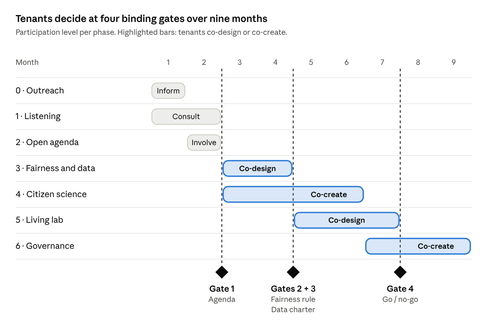

# C · Participation Blueprint

Deliverable C · Hybrid Participation Innovation Lab, Tor Vergata · **Next Wave**: Mahsa Shahi, Kuhyar Saeedi, Farida Safdari, Gelila Tsehaye Melesse, Md Nazmul Islam, Pranto Argha Sarker.

This blueprint sets out a 9-month hybrid process in which the tenants of a public housing complex in Tor Bella Monaca co-design an AI energy assistant for their solar energy community, including the rule it uses to share money. Tenants decide at four binding gates; every step works on-site and online, and nobody needs a smartphone to take part.

## 1. The participatory challenge

The developers' problem is not the final problem. Left to themselves, developers would ask: *"How can an AI assistant get tenants to shift their energy use to sunny hours, so the community earns the highest incentive?"* That framing hides six assumptions tenants could contest: that they are at home by day, that a bigger incentive is always better, that an app reaches everyone, that an equal split is fair, that sharing home data is harmless, and that tenants are users rather than decision-makers.

Imagining the voices on our stakeholder map (to be confirmed in the listening phase) shifts the problem:

| From (developers' view) | To (shared view) |
| --- | --- |
| Maximise the incentive | Share benefits in a way tenants find fair |
| Change tenants' behaviour | Fit the system to different routines |
| Equal split by default | A fairness rule decided together |
| App for everyone | App, paper, phone and a person |
| Collect all useful data | A data charter tenants approve |
| Automate appliances | Advise by default, automate only by choice |

**Our shared participatory question:** *Under what conditions can an AI energy assistant help the different households of a public housing complex share solar energy and its benefits in a way they find fair, understandable and under their control?*

It breaks into five questions tenants will decide: **fairness** (how the money is shared), **data** (what the AI may know, who sees it, for how long), **control** (advise or also switch appliances), **access** (how people without a smartphone take part fully) and **governance** (who runs the community and how decisions can be challenged). The question also allows the answer "it can't" for some households.

## 2. Who takes part

Not everyone has time to co-create, but everyone should be able to decide. We therefore run two tracks:

- **Wide track, every household.** Informed, consulted and voting at the gates, with little time and no smartphone needed.
- **Deep track, rotating volunteers (about 30 households).** They co-design and co-create, with childcare, flexible hours and recognition. Their proposals always return to the wide track for a decision.

Our stakeholder map (deliverable B) shows that the people closest to the technology hold the least power over it. The process must actively reach the groups who are usually absent: elderly people living alone, low-income and migrant families, shift workers, women carers, young people, people with disabilities and tenants without a regular contract. Institutions (ATER Roma, the City, GSE, the provider, Areti) take part as experts and owners, but on fairness and data only tenants vote.

## 3. Levels of participation and decision gates

We do not aim for the top level everywhere; we choose the right level for each phase, using the five levels inform, consult, involve, co-design and co-create. Phases 3 and 4 overlap on purpose, so that what citizen science discovers feeds the fairness and data decisions.

At each gate, tenants' choices bind the project:

| Gate | Month | What tenants decide |
| --- | --- | --- |
| 1 · Agenda | 2 | Which issues are co-designed first |
| 2 · Fairness rule | 4 | The rule that shares the money; the provider must implement it |
| 3 · Data charter | 4 | Which household data may be used, and by whom |
| 4 · Go or no-go | 7 | Whether to scale, change or stop the pilot, together with ATER |

Developers sign these gates in advance, so participation cannot be ignored afterwards. A no-go is a legitimate outcome.

## 4. Methods by purpose

Every method does a job in the chain; none is there for decoration. We reuse the three methods combined in the REGACE project (Open Space, World Café and a fishbowl; Antonucci et al., 2025), each placed where its job is needed.

| Purpose | Method | The task it performs |
| --- | --- | --- |
| Explore | Doorstep and walking interviews | Reach people who never come to meetings; see roofs, meters and shared spaces through tenants' eyes |
| Explore | Focus groups by group | Hear elderly people, migrant parents and shift workers in a safe setting, at their hours |
| Explore | Participatory mapping | Locate sun, shade, broken things and gathering points (paper map plus online map) |
| Open the agenda | Open Space day in the courtyard | Tenants propose and choose the topics to co-design (Gate 1) |
| Deliberate | Fairness assembly (about 25 tenants by stratified lottery, 3 evenings) | Decide the fairness rule for Gate 2 with a group that mirrors the complex |
| Deliberate | Scenario discussion with the Fair Share Simulator | Compare rules on concrete families, on screen and on paper |
| Deliberate | Fishbowl | Make disagreement visible and return results to all tenants |
| Generate ideas | World Café and co-design workshops | Ideas for messages, alerts, the paper channel and a draft data charter |
| Produce knowledge | Citizen science ("Energy Detectives") | Energy postcards, smart plugs, diaries and shade photos (deliverable D) |
| Test and adapt | Living lab pilot (3 months) and home usability tests | Run the assistant with volunteer households and check elderly and non-digital tenants can use it |

Three choices shape the set. We do not rely on surveys alone, because a survey cannot explain why a family cooks at 9 pm. Vulnerable groups speak first in their own spaces, then meet the others with their points ready. For the binding fairness decision, a lottery that mirrors the complex replaces self-selected volunteers. Household numbers are planning targets, not results.

## 5. Hybrid architecture

Digital tools give the process continuity; they do not copy meetings. Four rules hold throughout:

1. **Every online step has an offline twin.** Each vote, comment or survey also works on paper, by phone or in person.
2. **Meet to decide, go online to continue.** Decisions happen face to face; online keeps the thread between meetings.
3. **Information flows both ways.** Online comments are read aloud on site; on-site results are posted online within 48 hours.
4. **No smartphone needed.** Full participation is possible without any device, since unequal digital capital is itself a vulnerability (Antonucci, Sorice and Volterrani, 2022).

| Phase | On-site (live) | Online (mostly asynchronous) | How information moves |
| --- | --- | --- | --- |
| Outreach | Doorstep visits, info stand | WhatsApp broadcast, short videos | Questions from both sides feed the agenda |
| Listening | Interviews, focus groups | Short survey, online map | Weekly summary on the noticeboard and online |
| Open agenda | Open Space day | Live stream, topic voting for one week | Online votes added to on-site results |
| Fairness and data | Assembly, fishbowl | Simulator, comments on drafts | Online comments read aloud at the next session |
| Citizen science | Data evenings | App diary, dashboard | Paper postcards digitised by ambassadors |
| Living lab | Home visits, tests | Assistant, feedback button | Monthly "you said, we did" change log |
| Governance | CER assembly | Proxy and remote voting (within CER statutes) | Plain-language minutes on both channels |

Six channels carry one conversation: an **Energy Corner** noticeboard and suggestion box in the courtyard; young **energy ambassadors** who carry voices between paper and screen; a printed **monthly bulletin** in several languages; **WhatsApp** broadcast lists per language; a **web platform** with proposals, the simulator and the data dashboard; and a **phone line** where a person can vote and report for you. The Hybrid Journey Map (deliverable E) follows one tenant through these channels before, during and after the process.

Online access is not inclusion, so four measures support low digital skills: a weekly printed "sunny hours" calendar, SMS or a call instead of app notifications; a paper version of the simulator with household cards and coins; a help desk where ambassadors build skills rather than replace them; and paper votes that count exactly like online ones, counted in public.

## 6. Facilitation, inclusion and conflict

We go to people instead of waiting for them, and recruit through trusted bridges. The target is a fairness assembly that mirrors the complex by age, household type, origin and building.

| Group | How we reach them |
| --- | --- |
| Elderly tenants | Doorstep visits, the parish, the local senior centre, the phone line |
| Migrant families | Cultural mediators, community associations, translated leaflets |
| Shift workers | Evening and weekend slots, WhatsApp voice notes, asynchronous voting |
| Women carers | School gates, childcare during sessions, daytime meetings |
| Young people | Paid energy-ambassador roles, schools, sports clubs |
| Tenants without a contract | Trusted third-sector groups; no ID needed to join discussions |

**Accessibility.** Plain Italian with key materials translated and mediators present; every activity offered twice (weekday evening and Saturday morning); ground-floor rooms and home visits; large print, audio versions and accessible routes; childcare, snacks and a small voucher for long sessions.

**Power balance: experts on tap, not on top.** Facilitators are neutral (not from ATER or the provider) and are evaluated by participants after each session. Tenants speak first and experts answer questions. Anyone can raise a "say it simply" card. On fairness and data only tenants vote; institutions give opinions.

**Conflict is recorded, not hidden.** The facilitator names each disagreement in a public log; a fishbowl lets both sides explain their reasons; simulator or pilot data are used where facts can help; the vote at the gate decides, with minority views attached. If tenants disagree with the developers, the gates bind: the provider adapts or the pilot pauses, and an external mediator (for example the university) is called before any override.

## 7. Traceability and feedback

Every contribution can be followed from the person who made it to the decision it shaped.

- **Numbered proposals.** Each proposal gets a number, on paper and online. Its status is public: received, discussed, adopted, changed or refused with reasons.
- **A duty to answer.** A change request backed by citizen data goes to the assembly or the provider, who must answer within a month.
- **48-hour rule.** Session results are posted on both channels within 48 hours.
- **Monthly loop.** A "you said, we did" bulletin and a courtyard return event.
- **End of pilot.** Each household receives its own energy postcard in plain language.

The change log is also the raw material for our evaluation (deliverable G): it lets us compare the final design with the developers' frozen starting design and show what changed because tenants took part.

## References

- Antonucci, M. C., Volterrani, A., Serra, M., Cornaro, C., Petitta, M., and Bovesecchi, G. (2025). Transforming risk perception and fostering cooperatively the agri-photovoltaics technology with farmers in five countries: a sociological perspective from the REGACE project. *AgriVoltaics Conference Proceedings*, 3. [doi:10.52825/agripv.v3i.1386](https://doi.org/10.52825/agripv.v3i.1386)
- Antonucci, M. C., Sorice, M., and Volterrani, A. (2022). Social and digital vulnerabilities: the role of participatory processes in the reconfiguration of urban and digital space. *Frontiers in Political Science*, 4. [doi:10.3389/fpos.2022.970958](https://doi.org/10.3389/fpos.2022.970958)
- van Oudheusden, M., Berti Suman, A., Huyse, T., Huyse, H., and Medvecky, F. (2024). The valuable plurality of the citizen sciences. *Science & Technology Studies*, 37(1).
